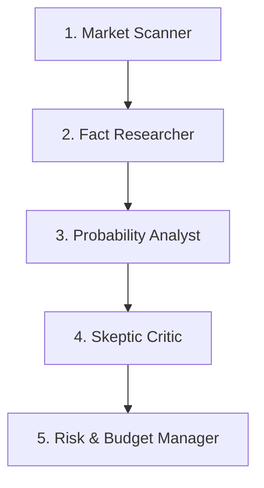

# Polymarket Simulation and Agentic Market Architecture

Agent executes probabilistic modeling through a modular multi-agent architecture.
This rule enforces strict falsification, risk management, and memory efficiency.

---

## 1. Multi-Agent Role Decomposition

Agent separates market simulation tasks into five distinct functional roles.

1. **Market Scanner**: Agent monitors binary prediction markets and filters active contracts.
2. **Fact Researcher**: Agent gathers primary source news and official statistical releases.
3. **Probability Analyst**: Agent calculates Brier scores and implied probability distributions.
4. **Skeptic Critic**: Agent attempts to falsify the trade thesis and identifies hidden risks.
5. **Risk & Budget Manager**: Agent sizes simulated positions strictly according to Kelly Criterion limits.

---

## 2. Scraping and Resource Optimization (Obscura Integration)

1. Agent collects market data using the `obscura-scraper` skill.
2. Agent connects Playwright instances to local Obscura CDP on port 9222.
3. Agent limits browser memory usage to 50 megabytes per scraping worker.
4. Agent runs headless data harvesting without launching heavy desktop Chrome instances.

---

## 3. Simulation Verification (Unlazy Integration)

1. Agent creates `GATES.md` before changing simulation algorithms.
2. Agent tests mathematical calibration routines with deterministic seed values.
3. Agent checks that all historical backtest assertions return exit code 0.
4. Agent enforces `token-budget-guard` during multi-agent simulation runs.
